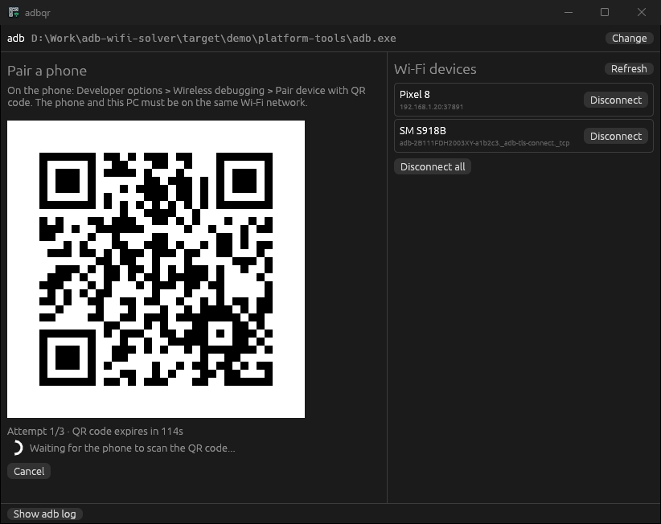
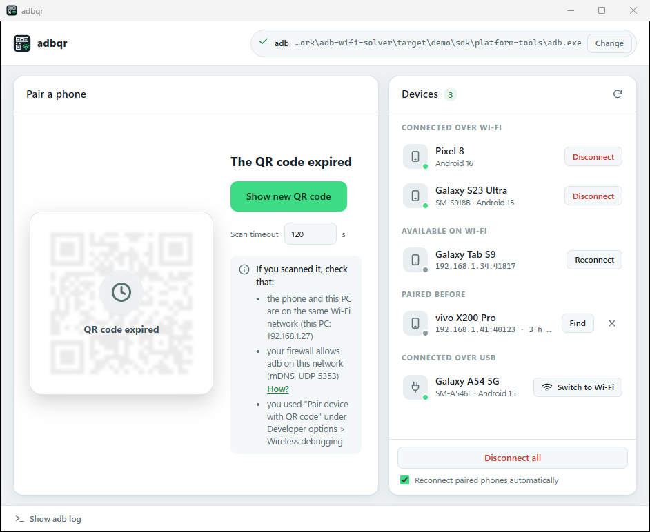

# ADB Wifi Solver

Android Studio is somehow.... Sometimes works, sometimes doesn't work at all. So, this will fix that "sometimes". At least on my machine.

`adbqr` is a small desktop app that shows a pairing QR code. Scan it on your phone and it pairs and connects ADB over Wi-Fi, no Android Studio needed. It also lists the devices connected over Wi-Fi and lets you disconnect and reconnect them.



## Usage

1. On the phone: **Developer options > Wireless debugging > Pair device with QR code**.
2. Open adbqr. A QR code is shown right away.
3. Scan it. adbqr pairs, connects, and shows `Connected: Pixel 8 (192.168.1.20:37891)`.

Each QR code is valid for the scan timeout (120 seconds by default; change it before showing a new code). If pairing fails, a new QR code is generated and tried again, 3 attempts in total. When a code expires, click **Show new QR code**:



### Disconnecting Wi-Fi devices

The **Wi-Fi devices** panel lists every device adb is connected to over Wi-Fi and refreshes every 2 seconds. USB devices and emulators are not listed. **Disconnect** ends a device's connection, and **Disconnect all** does it for every listed device.

- Devices listed by address (`192.168.1.20:37891`) are disconnected with `adb disconnect`.
- Devices listed by mDNS name (`adb-XXXX._adb-tls-connect._tcp`) can't be disconnected that way: `adb disconnect` only takes an address, and adb reconnects paired phones it finds on the network by itself. For these, adbqr turns off **Wireless debugging** on the phone, which drops the connection and keeps it dropped. Turn it back on in Developer options to reconnect; the pairing is kept.

### Reconnecting without a QR code

Pairing is kept, so a phone only needs the QR code once per PC. Under **Not connected**, the panel lists phones on the network that have Wireless debugging on but aren't connected to adb. **Reconnect** runs `adb connect` for that phone's address. This works without scanning only for phones paired with this PC before; other phones refuse the connection and need the QR code.

A phone with Wireless debugging off can't be reached from the PC. That includes phones disconnected by turning it off, and phones that changed Wi-Fi network or rebooted, since Android turns it off then. Turn it back on in Developer options, and the phone shows up under **Not connected** (or adb reconnects it on its own).

### Other controls

- **adb** (top bar): the adb that's in use. Click **Change** to point at a different `adb` or platform-tools folder.
- **Show adb log** (bottom): every adb command adbqr ran and what it printed. Useful when something goes wrong.

## Requirements

- Android 11 or newer (that's when wireless debugging was added)
- [Android SDK Platform-Tools](https://developer.android.com/tools/releases/platform-tools) 34 or newer. adb is looked up on `PATH`, then `ANDROID_HOME` / `ANDROID_SDK_ROOT`, then the default Android Studio SDK folder.
- Phone and computer on the same Wi-Fi network

## Install

**Windows:** download [`adbqr.exe`](https://github.com/adityawibisana/ADB-Wifi-Solver/releases/latest/download/adbqr.exe) from the [latest release](https://github.com/adityawibisana/ADB-Wifi-Solver/releases/latest). It's a single file with nothing to install; double-click to run.

**Any platform**, with [Rust](https://rustup.rs) installed:

```
cargo install --git https://github.com/adityawibisana/ADB-Wifi-Solver
```

Or build it from source:

```
git clone https://github.com/adityawibisana/ADB-Wifi-Solver
cd ADB-Wifi-Solver
cargo build --release
```

The app ends up in `target/release/adbqr` (`adbqr.exe` on Windows). On Windows the C runtime is linked statically, so the .exe runs on its own. On Linux, building needs the usual X11/Wayland development packages (for example `libxkbcommon-dev`, `libwayland-dev`, `libx11-dev`, `libgl1-mesa-dev`).

## Troubleshooting

- **Nothing happens after scanning.** Pairing is found over mDNS (UDP 5353). Make sure your firewall allows adb on this network. On Windows, the network should be set to *Private*.
- **"mDNS is unavailable" warning.** Update platform-tools.
- **A disconnected phone comes back.** For phones listed by mDNS name, Disconnect turns off Wireless debugging; if it's turned back on, adb reconnects. Check the adb log for what happened.
- **Something else.** Open **Show adb log** to see every adb command and what it printed.

## How it works

1. Generates a random service name and password and shows them as a `WIFI:T:ADB;S:<name>;P:<password>;;` QR code, the same format Android Studio uses.
2. After the scan, the phone advertises an `_adb-tls-pairing` mDNS service under that name. adbqr waits for it to appear in `adb mdns services`.
3. Runs `adb pair <addr> <password>`.
4. Waits for the phone's `_adb-tls-connect` service and runs `adb connect` if adb doesn't connect on its own.

The window is built with [egui](https://github.com/emilk/egui).

## License

[MIT](LICENSE)
