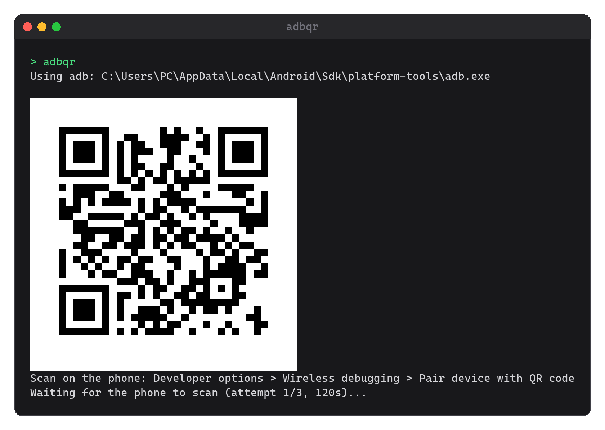
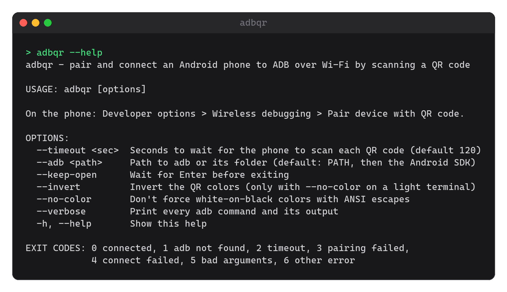

# ADB Wifi Solver

Android Studio is somehow.... Sometimes works, sometimes doesn't work at all. So, this will fix that "sometimes". At least on my machine.

`adbqr` shows a pairing QR code right in your terminal. Scan it on your phone and it pairs and connects ADB over Wi-Fi, no Android Studio needed.



## Usage

On the phone: **Developer options > Wireless debugging > Pair device with QR code**, then run:

```
adbqr
```

Scan the QR code. When it's done you'll see something like:

```
Paired.
Connecting to 192.168.1.20:37891...

Connected: 192.168.1.20:37891 (Pixel 8)
```

If a scan fails, it makes a new QR code and tries again (3 attempts in total).

### Options



<details>
<summary>Options as text</summary>

```
--timeout <sec>  Seconds to wait for the phone to scan each QR code (default 120)
--adb <path>     Path to adb or its folder (default: PATH, then the Android SDK)
--keep-open      Wait for Enter before exiting (handy when double-clicking the .exe)
--invert         Invert the QR colors (only with --no-color on a light terminal)
--no-color       Don't force white-on-black colors with ANSI escapes
--verbose        Print every adb command and its output
-h, --help       Show help
```

</details>

Exit codes: `0` connected, `1` adb not found, `2` timeout, `3` pairing failed, `4` connect failed, `5` bad arguments, `6` other error.

## Requirements

- Android 11 or newer (that's when wireless debugging was added)
- [Android SDK Platform-Tools](https://developer.android.com/tools/releases/platform-tools) 34 or newer. adb is looked up on `PATH`, then `ANDROID_HOME` / `ANDROID_SDK_ROOT`, then the default Android Studio SDK folder.
- Phone and computer on the same Wi-Fi network

## Install

With [Rust](https://rustup.rs) installed:

```
cargo install --git https://github.com/adityawibisana/ADB-Wifi-Solver
```

Or build it from source:

```
git clone https://github.com/adityawibisana/ADB-Wifi-Solver
cd ADB-Wifi-Solver
cargo build --release
```

The binary ends up in `target/release/adbqr` (`adbqr.exe` on Windows). On Windows the C runtime is linked statically, so the .exe runs on its own.

## Troubleshooting

- **Nothing happens after scanning.** Pairing is found over mDNS (UDP 5353). Make sure your firewall allows adb on this network. On Windows, the network should be set to *Private*.
- **The QR code won't scan.** Make the terminal window bigger so the whole code fits. On a light terminal theme, try `--no-color --invert`.
- **"mDNS is unavailable" warning.** Update platform-tools.
- **Something else.** Run with `--verbose` to see every adb command and what it printed.

## How it works

1. Generates a random service name and password and shows them as a `WIFI:T:ADB;S:<name>;P:<password>;;` QR code, the same format Android Studio uses.
2. After the scan, the phone advertises an `_adb-tls-pairing` mDNS service under that name. adbqr waits for it to appear in `adb mdns services`.
3. Runs `adb pair <addr> <password>`.
4. Waits for the phone's `_adb-tls-connect` service and runs `adb connect` if adb doesn't connect on its own.

## License

[MIT](LICENSE)
